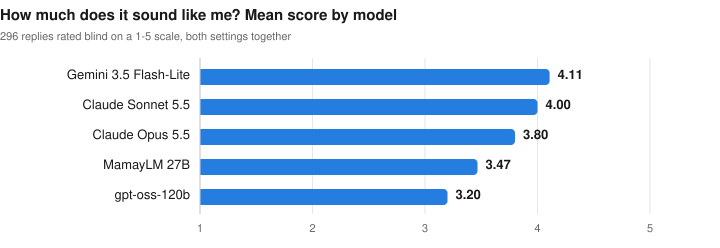
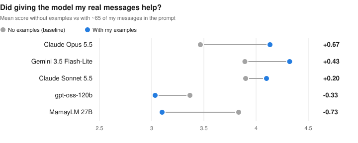
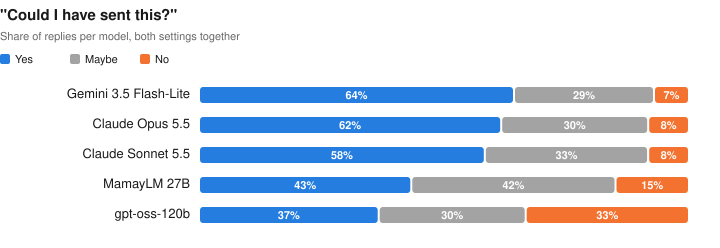
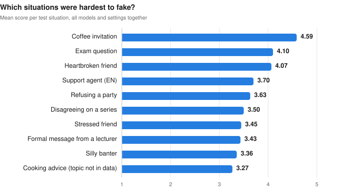

# Can an LLM text like me?

A small experiment: five LLMs were asked to write chat replies **in my personal texting style** (mostly Ukrainian, some English), and I rated all their replies blind. It started as a course project for *Deep Learning for Cognitive Computing* (University of Jyväskylä), where the brief was to build a "cognitive profile" of a person with online AI services and to evaluate them critically, privacy included.

**Short answer:** the best models sound like me most of the time in everyday chat. Gemini 3.5 Flash-Lite, Claude Sonnet 5.5 and Claude Opus 5.5 came out on top, close enough that the data cannot separate them. Giving a model real examples of my messages helped some models a lot and made others worse.

## Setup

| | |
|---|---|
| **Models** | Gemini 3.5 Flash-Lite (Google API), Claude Sonnet 5.5 and Claude Opus 5.5 (Anthropic API), MamayLM 27B (a Ukrainian-tuned model, Mamay AI API), gpt-oss-120b (on Groq) |
| **Situations** | 10 new chat situations not taken from my data: a coffee invitation, refusing a party, a heartbroken friend, a formal message from a lecturer, silly banter, a support agent, and more ([`code/scenarios.json`](code/scenarios.json)) |
| **Two settings** | **baseline**: "reply like a casual texter", no examples · **examples**: ~25 of my real replies (with a one-line summary of what the other person said) plus ~40 standalone messages in the system prompt |
| **Volume** | 3 runs per model × situation × setting = **296 replies** (4 Gemini requests failed) |
| **Rating** | I rated every reply blind (model and setting hidden, order shuffled): a 1-5 score for "sounds like me" and yes / maybe / no for "could I have sent this?" |

## Results



The top three are within noise of each other. All three are clearly ahead of gpt-oss-120b (p ≤ 0.004) and, for Gemini and Sonnet, ahead of MamayLM (p ≤ 0.012). These are permutation tests with no correction for multiple comparisons, so read them as a rough guide.



**Examples are not automatically better.** Pooled over all models they changed nothing (3.73 vs 3.69). Model by model, Claude Opus improved the most (+0.67, p = 0.007) and MamayLM got worse (−0.73, p = 0.032). With examples, MamayLM sometimes fell into runaway replies (15+ lines, or one line repeated over and over). Without examples it was as good as the best baselines.



The single best setting was **Gemini with examples: mean 4.32, and 22 of 28 replies were "yes, I could have sent this".**



Short, neutral situations are easy. Topics that never appear in my data (cooking), silly banter, and the **formal register** are hard. The formal message from a lecturer split the models the most: Gemini scored 4.8 and Sonnet 4.7, while gpt-oss scored 2.2 and MamayLM 2.0, even though my data contains almost no formal writing.

| A lecturer writes: *"Добрий день! Чи зможете надіслати завдання до п'ятниці?"* | Score |
|---|---|
| Claude Opus, examples: *Добрий день! Так, звісно, надішлю до п'ятниці. / Дякую!* | 5 |
| MamayLM, examples: *ага я вже роблю! мені здається я впораюсь до того часу! може навіть і раніше! :)* | 1 |
| gpt-oss, examples: *Привіт! 🙏 / Спробую вкластись до п'ятниці, хоча зараз трохи завалена. / …* | 1 |

### What gave a model away

- **Emoji.** Replies with an emoji averaged 3.15 and those without averaged 3.88. Only about 1% of my real messages contain one.
- **Length.** Replies of 7+ lines averaged 3.00; replies of 1-6 lines averaged about 3.7-3.8.
- **Broken Ukrainian.** Phrases that do not make sense came mostly from gpt-oss and MamayLM.
- **Leaks.** Redaction tokens from my cleaned data (`[place]`, `[month]`) leaked into 6 replies. One Sonnet reply repeated the instruction text, and one Gemini reply slipped in a Polish word.
- **Copying.** No model copied my messages: a check for repeated five-word phrases found none.

## Privacy: which providers got my data

This kind of test needs real private messages, so each provider's API terms were checked before anything was sent. Only cleaned text went out: my own messages, with no names or phone numbers, and other people's messages replaced by a one-line summary.

| Provider | Trains on API data? | Retention | Decision |
|---|---|---|---|
| Anthropic (Claude) | No, excluded by the commercial terms | Deleted within 30 days (longer if flagged) | Used |
| Google Gemini | **Free tier: yes**, and human reviewers may read prompts. Paid tier: no | Paid tier: "limited period" | Used (paid tier only) |
| Groq | Not stated on its public pages | Zero data retention available | Used, with zero retention switched on |
| Mamay AI (INSAIT, Bulgaria) | No | Requests processed only as needed; IP addresses kept 7 days | Used; EU controller |
| OpenAI | No by default | Abuse logs up to 30 days | Key ready, not run |
| Mistral | API: opt-out available. Le Chat: yes by default | Not clearly stated | Not run |
| DeepSeek (hosted) | Yes | Kept while the account exists; **stored in China** | Rejected |
| Microsoft Copilot (consumer) | Reportedly yes by default on personal accounts | Conflicting figures | Rejected |

The policies were checked in November 2026, and they change. Re-check them before reusing this table.

## Limits

- **One rater, who is also the subject.** Blind ratings from friends, and a control with my real messages mixed in, were planned but not done.
- **Small samples.** 56-60 replies per model, and the 3 runs of a situation are not independent.
- **One untuned prompt.** It never told models to keep replies short or skip emoji.
- **Different settings per model.** The Claude models ran at their default temperature; the rest ran at 0.9. The results rank these specific services with this prompt, not model families in general.

## Run it yourself

The harness uses only the Python standard library.

```bash
cp .env.example .env          # add keys for the providers you want
python3 code/imitate.py --dry-run                     # print a prompt, no API calls
python3 code/imitate.py --models claude-sonnet --runs 3
python3 code/imitate.py --list-models gemini          # see what a key can access
```

Models are configured in [`code/models.json`](code/models.json), and situations in [`code/scenarios.json`](code/scenarios.json). Each run writes `results/run_<time>/blind.csv` (replies only, for raters) and `key.csv` (which model wrote what).

**Using your own messages.** Put your files in `data/`, which git ignores:

- `style_data.csv`: your replies, each with a summary of what the other person said
- `instagram_sample_500.csv`: standalone messages

The column formats are the same as in [`examples/`](examples/), which holds a handful of my real messages so the code runs out of the box. [`code/sample_instagram.py`](code/sample_instagram.py) draws a sample balanced across chats from a larger message export.

To redraw the charts from [`results/ratings.csv`](results/ratings.csv) (scores only, no reply text), run `python3 code/make_charts.py`.

## Repository layout

```
code/imitate.py           test harness: prompt building, API calls for 7 providers, blind/key output
code/models.json          model list (enable/disable per run)
code/scenarios.json       26 test situations (10 used in the rated set)
code/make_charts.py       README charts from results/ratings.csv
code/sample_instagram.py  balanced sampling of your own messages
examples/                 tiny public sample of the data format
results/ratings.csv       all 296 scores (model, setting, situation, score, emoji, length)
assets/                   charts
```

My full message data, the raw replies and the course materials are not in this repo.
